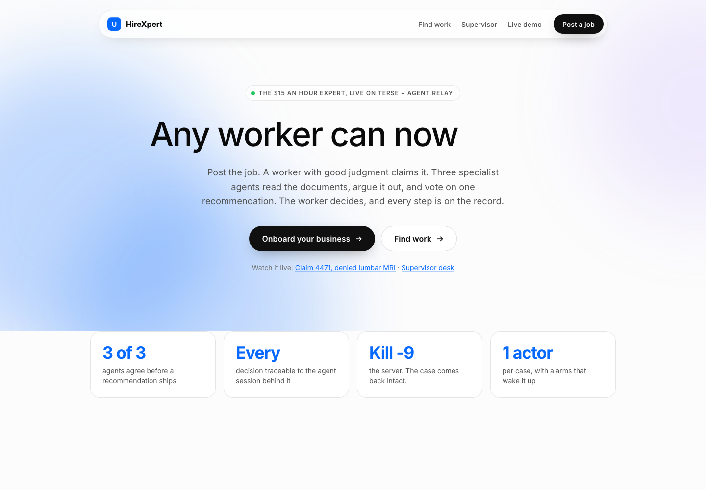
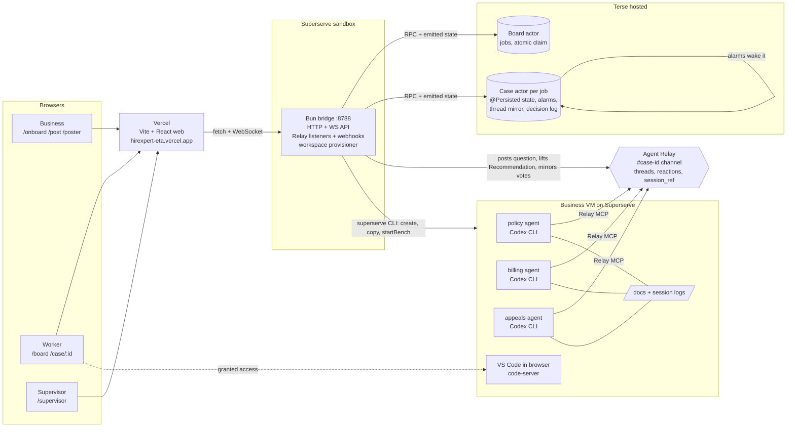
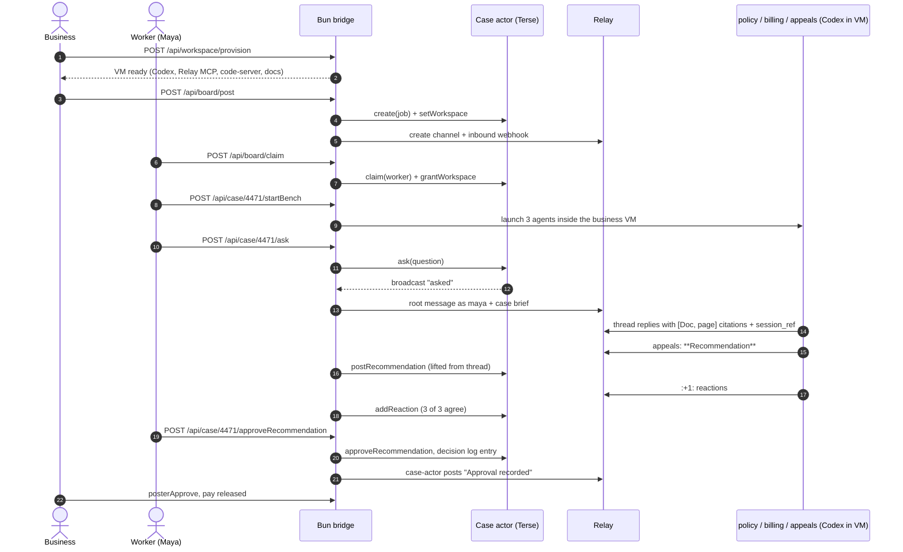
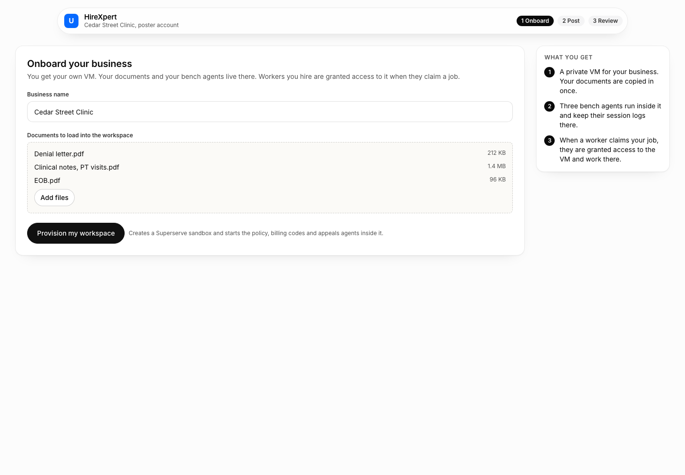
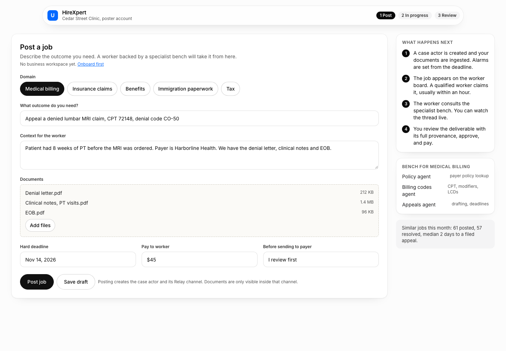
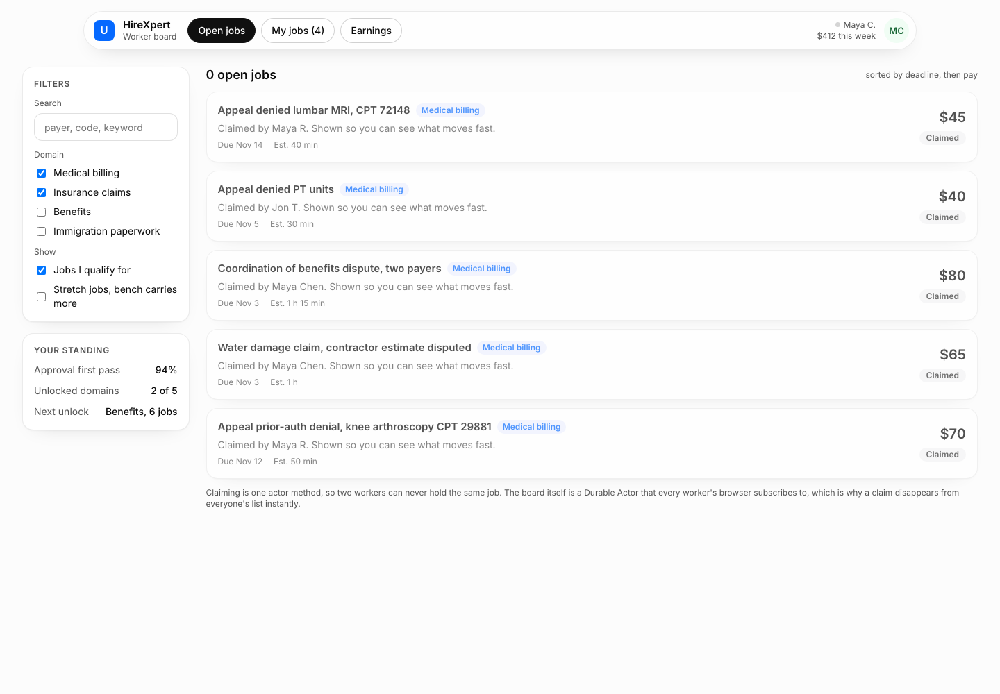
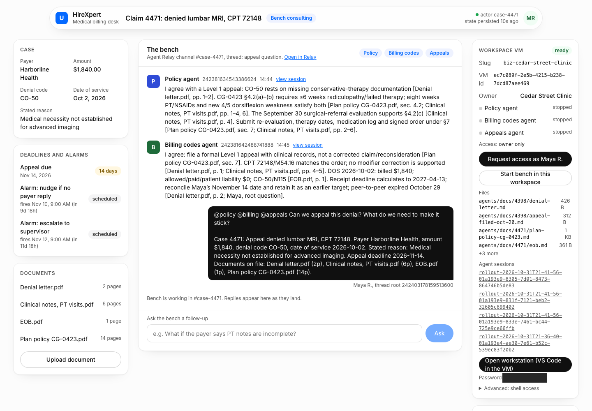
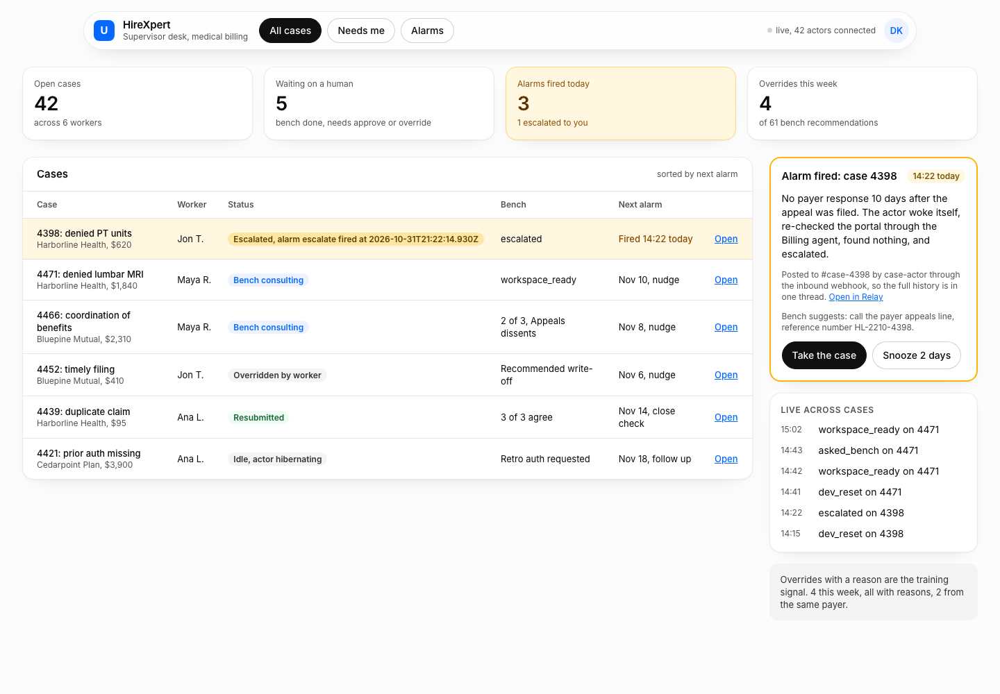

<div align="center">

# HireXpert

**The $15 an hour expert.** A worker with good judgment claims a job that used to need a credential, consults a bench of three Codex agents running in the business's own VM, and approves what they agree on. Every decision traces back to the document and the agent session behind it.

[](#sponsor---exactly-how-we-use-it)
[](#sponsor---exactly-how-we-use-it)
[](#sponsor---exactly-how-we-use-it)
[](https://github.com/openai/codex)
[](https://hirexpert-eta.vercel.app)
[](#what-it-does-in-60-seconds)
[](#license)

[**Live app**](https://hirexpert-eta.vercel.app) · [Worker view](https://hirexpert-eta.vercel.app/case/4471) · [Supervisor](https://hirexpert-eta.vercel.app/supervisor) · [Run it locally](#run-it-locally)



</div>

---

## What it does, in 60 seconds

A clinic has a denied insurance claim: lumbar MRI, CPT 72148, denial code CO-50, $1,840. Fixing it normally takes a certified billing specialist. With HireXpert:

1. **The business onboards.** It gets its own private **Superserve VM** with the Codex CLI, the Agent Relay MCP server, VS Code in the browser (code-server), its uploaded documents, and every agent session log.
2. **It posts the job.** A Terse **Board** actor creates a **Case** actor for the job and the bridge opens an Agent Relay channel `#case-<id>`.
3. **A worker claims it.** Claims are atomic (a second claim is rejected), and the claim grants the worker access to the business VM.
4. **Start bench.** Three Codex agents start inside that VM: **policy**, **billing codes** and **appeals**. The worker asks one question; they read the documents, argue in one thread, cite `[Doc, section/page]`, and every reply carries a `session_ref`.
5. **Appeals posts a `**Recommendation**`.** Reactions are votes. When it reads **3 of 3 agree**, the worker approves or overrides with a reason. Either way it lands in the decision log.
6. **The business reviews and pays.** If nobody acts, Terse alarms wake the case and escalate it to the Supervisor. Kill the server and the case comes back intact, alarms included.

This build is codename Understudy: the worker is the understudy, the agents are the coaches, and the human still makes the call.

## Architecture



## One job, end to end



## Three easy steps

### 1. Onboard your business

One form. You get a private VM with your documents and your own bench of agents.



### 2. Post the job

Describe the outcome, attach documents, set a deadline and the pay. Posting creates the case actor, its alarms and its Relay channel.



Workers pick it up from the board:



### 3. The worker consults the bench and decides

The worker sees the case, the deadlines and alarms, the bench thread, and the business VM with its live agents, files, session logs and a one-click VS Code workstation.



## What the agents do

Each agent is a Codex CLI session with a role prompt (`agents/policy.md`, `agents/billing.md`, `agents/appeals.md`) plus shared rules (`agents/_common.md`): read every document first, cite every claim as `[Doc, section/page]`, stay under 90 words, disagree once then converge, and only the appeals agent posts the `**Recommendation**`.

Real replies from case 4471 (from `docs/screens/worker.png`):

> **Policy agent:** "CG-0423 §4.2(a)–(b) requires ≥6 weeks radiculopathy/failed therapy; eight weeks PT/NSAIDs and new 4/5 dorsiflexion weakness satisfy both [Plan policy CG-0423.pdf, sec. 4.2; Clinical notes, PT visits.pdf, pp. 1–4, 6]."

> **Billing codes agent:** "I agree: file a formal Level 1 appeal with clinical records, not a corrected claim/reconsideration [Plan policy CG-0423.pdf, sec. 7]."

The recommendation they converge on is lifted into the Case actor, the worker sees **3 of 3 agree**, and each reply links to the session that produced it.

## Sponsor -> exactly how we use it

| Sponsor | Exactly how we use it |
|---|---|
| **Terse** (Durable Actors) | One `Case` actor per job and one `Board` actor. All case state is `@Persisted @Emittable`: claim, facts, documents, deadlines, alarms, thread mirror, recommendation, votes, decision log, pay, workspace. `this.alarm.set()` + `onAlarm()` drive nudges and escalations. Every screen is a WebSocket client of the same actor. Hosted via `terse deploy`. |
| **Agent Relay** | One channel `#case-<id>` per job. The worker's question is the thread root; agents reply in-thread through the Relay MCP server; `:+1:` reactions are votes; `RELAY_ATTEST_SESSION_ID` gives every reply a `session_ref`. The case actor posts alarms and approvals into the same thread via an inbound webhook. |
| **Superserve** | Two jobs: (1) the sandbox that runs the Bun bridge and the built web publicly on :8788; (2) one VM per business, provisioned by `bridge/workspace.ts` through the `superserve` CLI, holding the Codex CLI, Relay MCP, code-server, uploaded docs (PDF text extracted) and agent session logs. |
| **OpenAI (Codex)** | The three bench agents are `codex` CLI sessions (`agents/launch.sh`) with role prompts, reading documents with the shell and talking over Relay MCP. Their `~/.codex/sessions/*.jsonl` logs are listed on the worker card as provenance. |
| **Vercel** | Hosts the Vite + React web at [hirexpert-eta.vercel.app](https://hirexpert-eta.vercel.app), built against the Superserve bridge (`deploy/vercel.sh`). |

## Durability and provenance

- **Kill and restart.** The Case actor is the system of record. We killed `terse actor dev`, restarted it, reloaded `/case/4471`: claim, thread, recommendation and pending alarms were all intact (`actor/client/durability.ts`). On hosted Terse the actor also hibernates after idle and wakes with its state.
- **Alarms.** Each case keeps logical alarms (nudge, escalate) and re-arms one hardware alarm to the earliest unfired one. When it fires, `onAlarm()` wakes the actor, the status becomes `escalated`, the Supervisor row turns amber, and the case actor posts the event into `#case-<id>`.



- **`session_ref`.** Every agent runs with its own `RELAY_ATTEST_SESSION_ID`, so every reply in the thread points to the exact Codex session that wrote it ("view session" on the worker screen).
- **Decision log.** Approve and override (with reason) are persisted on the actor. Overrides with a reason are the training signal the Supervisor sees.

## Repo layout

```
.
├── actor/            Terse project: Case + Board actors (src/actor.ts)
│   └── client/       generated client, smoke.ts, durability.ts
├── bridge/           Bun process: HTTP + WS API, Relay listeners, webhooks
│   ├── server.ts     routes
│   ├── workspace.ts  per-business Superserve VM provisioning + startBench
│   ├── listeners.ts  lifts **Recommendation**, reactions into the actor
│   └── setup.ts      Relay workspace, agent tokens, webhooks -> .env
├── agents/           policy.md, billing.md, appeals.md, _common.md, launch.sh, docs/
├── web/              Vite + React (Landing, Onboard, Post, Board, Worker, Poster, Supervisor)
├── seed/             seed-cases.ts (cases 4471 and 4398 + board jobs)
├── deploy/           superserve.sh, vercel.sh
├── docs/screens/     screenshots
└── mockups/          HTML designs the screens were ported from
```

## Run it locally

Prerequisites: Bun 1.4.2+, Node 22+, the Terse CLI (`bunx terse-cli@latest install`), the Codex CLI (`npm i -g @openai/codex`), and a repo-root `.env` (keys listed in `bridge/.env.example`; `bun bridge/setup.ts` writes the Relay ones).

```bash
# 1. Durable Actors on :7100
cd actor && bun install && terse actor dev

# 2. Bridge: Relay workspace, actions, webhooks, API on :8788
cd bridge && bun install && bun setup.ts && bun index.ts

# 3. Web on :5173
cd web && bun install && bun run dev

# 4. Seed cases 4471 and 4398 (4398 escalates in 60 s)
bun seed/seed-cases.ts --alarm-seconds 60

# 5. Bench agents (one terminal each), or click "Start bench" to run them in the business VM
agents/launch.sh policy 4471
agents/launch.sh billing 4471
agents/launch.sh appeals 4471
```

Open http://localhost:5173/case/4471 and ask the bench a question. Run only one bridge at a time, or Relay gets double posts.

To use hosted actors instead: `terse deploy` from `actor/`, export `TERSE_ACTOR_URL` and `TERSE_API_KEY`, run `terse actor generate` in `actor/client`, and start the bridge with `TERSE_READY=1`.

## Deploy

```bash
deploy/superserve.sh   # build web, tarball bridge + web + agents, copy into the Superserve sandbox, restart bridge, publish :8788
deploy/vercel.sh       # build web against the Superserve bridge, deploy to the Vercel project "hirexpert"
```

| What | Where |
|---|---|
| Web (Vercel) | https://hirexpert-eta.vercel.app |
| Bridge + web (Superserve) | https://8788-5975fada-698b-4c43-8ec3-1e554ae9d97c.sandbox.superserve.ai |
| Actors (Terse hosted) | https://api.useterse.ai/cmvwuohyf00zwjy2a2dm8cjel/actors |

## Bridge API

Case and Board method calls take a JSON array of positional arguments as the body (`[]` for none).

| Method | Route | What it does |
|---|---|---|
| GET | `/api/case/:id` | Current Case actor state |
| POST | `/api/case/:id/:method` | Call any Case method (`ask`, `approveRecommendation`, `overrideRecommendation`, `scheduleAlarm`, `fireDueAlarms`, `posterApprove`, `devReset`, ...) and run bridge side effects (Relay posts, reactions) |
| GET | `/api/case/:id/ws-url` | WebSocket URL for live case state |
| POST | `/api/case/:id/startBench` | Launch the three Codex agents inside the business VM for this case (provisions the VM first if missing) |
| GET | `/api/board` | All jobs on the board |
| POST | `/api/board/:method` | `post` (creates Case actor + Relay channel + webhook) or `claim` (atomic, grants VM access) |
| GET | `/api/board/ws-url` | WebSocket URL for the live board |
| GET | `/api/workspace` | List business workspaces |
| POST | `/api/workspace/provision` | `[{ "owner": "Cedar Street Clinic", "force": false }]`: create or upgrade the business VM |
| GET | `/api/workspace/:slug` | Live VM status: running agents, files, Codex session logs, IDE URL |
| POST | `/api/workspace/:slug/files` | Multipart upload into the VM at `agents/docs/business` (PDF text extracted) |
| GET | `/health` | Bridge health and store kind |

## FAQ

**Is the worker just rubber-stamping the AI?** No. The worker sees disagreements in the thread, the citations and the sessions, and can override with a reason. Overrides are logged and surface on the Supervisor desk.

**Why one VM per business?** The documents never leave the business's machine. Agents read them there, logs stay there, and a worker gets access only after claiming that business's job.

**What if the agents never agree?** No recommendation reaches 3 of 3, the case stays in bench consulting, and the deadline alarms nudge and then escalate it to the Supervisor.

**What happens if the server dies mid-case?** Nothing is lost. State and pending alarms live in the Terse actor, not in the bridge.

**Is it only for medical billing?** The demo bench is medical billing. The post form already lists insurance claims, benefits, immigration paperwork and tax; a new domain is a new set of role prompts.

## License

MIT
